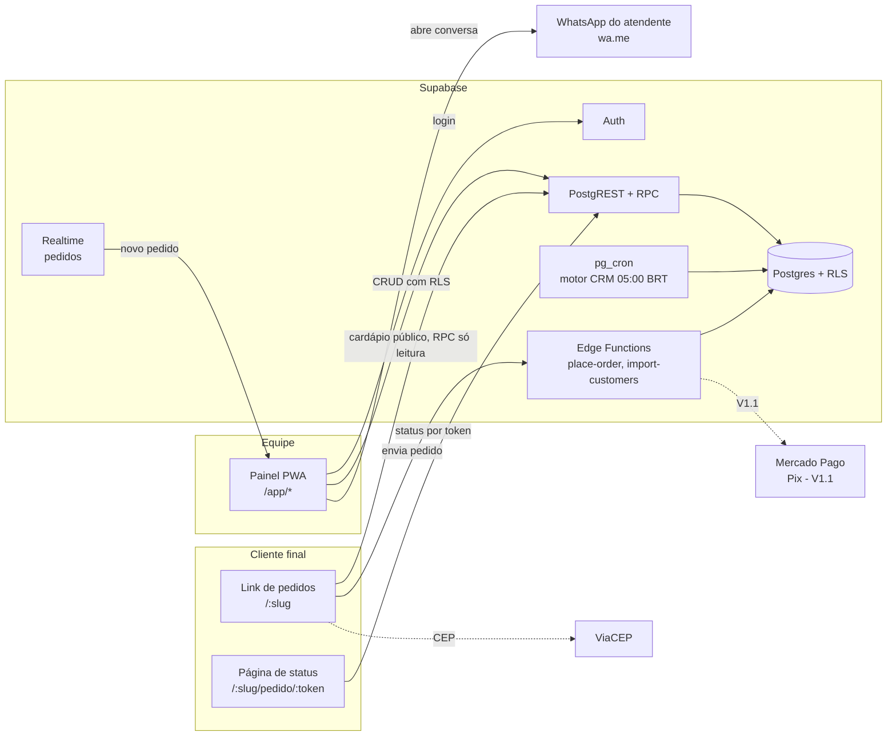

# PRD: Sistema para Pizzarias com CRM Inteligente

| Campo | Valor |
|---|---|
| Versão | 0.1 (rascunho para validação) |
| Data | 2026-11-08 |
| Status | Aguardando validação das decisões da seção 4 |
| Fonte | [`docs/briefing-original.md`](./briefing-original.md) |
| Próximo passo | Validar as decisões em aberto da seção 4.2 e só depois iniciar a Fase 0 do plano (seção 15) |

> **Como ler este documento.** As seções 1 a 3 trazem o porquê. A seção 4 lista o que foi
> **decidido por padrão** (e pode mudar) e o que **ainda precisa de você**. As seções 5 a 11
> trazem o quê: escopo, fluxos, requisitos e regras. As seções 12 a 14 trazem o como:
> arquitetura e dados. A seção 15 é o plano do MVP.
>
> Convenções: `RF-xx` = requisito funcional, `RN-xx` = regra de negócio, `RNF-xx` =
> requisito não funcional. **[MVP]**, **[V1.1]** e **[V2]** indicam em que versão cada item entra.

---

## 1. Resumo executivo

Um sistema operacional enxuto para pizzarias: **link próprio de pedidos**, **painel de
operação** (pedidos, status, caixa) e um **CRM que trabalha sozinho**. Todo pedido alimenta
o histórico do cliente. Toda noite, o sistema transforma esse histórico numa lista curta de
**oportunidades em linguagem simples** ("37 clientes estão perto de 30 dias sem pedir"), cada
uma com uma **mensagem pronta e personalizada**. O dono revisa e envia em poucos toques.
O sistema então **mede quantos desses clientes voltaram a comprar**.

O ciclo que o produto precisa fechar, e provar com números, é:

```
PEDIDO → HISTÓRICO → INTELIGÊNCIA → OPORTUNIDADE → CAMPANHA → NOVO PEDIDO (atribuído)
```

**Tese do MVP:** uma pizzaria pequena ou média, sem ninguém de marketing, recupera clientes
inativos usando apenas o que o sistema sugere. O MVP serve para provar essa tese com 1 a 3
pizzarias piloto.

---

## 2. Problema, visão e princípios

### 2.1 Problema
- O dono não tem tempo nem formação para ler relatórios. Os dados existem, mas ninguém age sobre eles.
- Depender de marketplaces custa comissão e **esconde o cliente**: a pizzaria não fica com
  o contato nem com o histórico de quem compra por lá.
- Pedidos chegam por WhatsApp, telefone e balcão, cada um num lugar diferente. Há redigitação e erro.
- Ninguém percebe quando um cliente fiel some, e quando alguém percebe já é tarde.

### 2.2 Visão
> **O sistema pensa pelo dono da pizzaria e mostra o que merece atenção hoje.**

### 2.3 Princípios de produto (filtro para toda decisão)
| # | Princípio | Implicação prática |
|---|---|---|
| P1 | Simplicidade acima de quantidade de funcionalidades | Uma função nova só entra no MVP se o piloto não funcionar sem ela |
| P2 | Ação acima de relatório | Nenhum número na tela sem uma frase explicando o que ele significa e qual ação fazer |
| P3 | Automação com controle | O sistema sugere e prepara; **nenhuma mensagem sai sem um humano aprovar** |
| P4 | Personalização baseada em fatos | A mensagem só cita o que está no histórico. Nada inventado, nenhuma promessa que a pizzaria não fez |
| P5 | Operação integrada | Pedido do link cai pronto no painel, sem redigitação |
| P6 | Linguagem comum | "Clientes que sumiram", não "churn". "Valor médio do pedido", não "ticket médio" (na UI) |
| P7 | Medir o resultado | Toda campanha registra o contato e mostra se o cliente voltou |

### 2.4 O que o produto NÃO é
- Não é um ERP genérico: no MVP não tem estoque, fiscal, contas a pagar, DRE ou BI.
- Não é um painel de dashboards para acompanhar todo dia.
- Não é ferramenta de disparo em massa nem de spam.
- Não é marketplace: cada pizzaria tem seu próprio link e sua própria marca.

---

## 3. Personas e trabalhos a realizar

| Persona | Contexto | Trabalho principal | Medo |
|---|---|---|---|
| **Dono(a)** | Trabalha na operação, olha o sistema no celular nos intervalos | "Me diga o que fazer para vender mais hoje" | Perder tempo com sistema complicado; incomodar cliente com mensagem |
| **Atendente / caixa** | Rush das 19h às 22h, várias coisas ao mesmo tempo | Registrar e acompanhar pedidos sem errar; fechar o caixa sem diferença | Pedido perdido, pedido errado, caixa que não bate |
| **Cozinha** | Mãos ocupadas, olha a tela ou a comanda impressa | Saber o que preparar e em que ordem | Pedido que chegou e ninguém viu |
| **Cliente final** | Pede pelo celular, geralmente vindo do WhatsApp ou do Instagram | Pedir rápido, saber o preço com frete antes de fechar, acompanhar o pedido | Formulário longo; não saber quando a pizza chega |
| **Entregador** [V2] | Na rua | Saber endereço, valor e forma de pagamento | Endereço errado; troco errado |

---

## 4. Decisões

### 4.1 Decisões assumidas por padrão
As 12 perguntas da seção 12 do briefing receberam uma resposta padrão para o PRD poder
avançar. **Toda linha pode ser mudada.** A coluna "Custo de mudar depois" diz o quanto
dói trocar a decisão depois de construído.

| # | Questão do briefing | Decisão padrão | Por quê | Custo de mudar depois |
|---|---|---|---|---|
| D1 | Delivery, retirada ou ambos? | **Ambos**, mais pedido de balcão/telefone lançado pela equipe | Cobre o dia a dia real; retirada não tem frete, então é barata de incluir | Baixo |
| D2 | Regra de frete | **Por bairro** (tabela bairro → taxa + tempo extra), com CEP autopreenchendo o endereço | É o modelo mais comum em pizzaria, não precisa de mapa nem de API paga, e o dono entende | Médio: distância/raio entra na V1.1 sem refazer o pedido |
| D3 | Status do pedido | **Novo → Em preparo → Pronto → Saiu para entrega / Aguardando retirada → Concluído**, mais **Cancelado** | Mínimo que a cozinha e o balcão precisam; ver seção 9 | Baixo |
| D4 | Caixa | **Caixa simples:** abertura com troco, recebimentos por forma de pagamento, sangria/suprimento, fechamento com conferência. Sem conciliação bancária | A aba "Caixa" está na navegação principal do briefing; conciliação é ERP | Baixo |
| D5 | Pagamento no link | **MVP: pagamento na entrega/retirada** (dinheiro com troco, cartão na maquininha, Pix na entrega). **V1.1: Pix online** via Mercado Pago | Pagamento online traz webhook, estorno e conciliação. Não é necessário para provar a tese do CRM | Médio |
| D6 | Cliente acompanha o pedido? | **Sim**, por uma página de status (link recebido ao finalizar), sem login | Corta as ligações de "cadê minha pizza" e custa pouco | Baixo |
| D7 | Canal das campanhas | **MVP: WhatsApp via link `wa.me`** com a mensagem preenchida; o atendente confere e envia no próprio WhatsApp. **V2: WhatsApp Business API** oficial para envio automático | Custo zero, sem credencial, sem risco de bloqueio do número, e atende o P3 (humano aprova) | Médio: a API oficial é paga por conversa, exige templates aprovados e opt-in formal |
| D8 | Consentimento e descadastro | **Opt-in explícito** no checkout (caixa desmarcada) e no cadastro de balcão; opt-out a qualquer momento pelo painel ou por pedido do cliente; registro de quando, onde e como | LGPD: mensagem promocional exige base legal; consentimento é a mais segura | Alto se for ignorado: retroativo é impossível |
| D9 | Limite de frequência | No máximo **1 contato promocional a cada 7 dias** e **4 a cada 30 dias** por cliente (configurável) | Evita a sensação de spam e protege o número de WhatsApp da pizzaria | Baixo |
| D10 | Identificação do cliente | **Celular (formato E.164) como chave única por pizzaria**; mesclagem manual de duplicados [V1.1] | O telefone é o que o cliente sempre informa e é por onde a campanha chega | Alto: é a espinha do CRM |
| D11 | Unidades, usuários e permissões | **Multi-pizzaria (SaaS) no modelo de dados desde o início**, 1 loja por pizzaria no MVP; papéis **Dono** e **Atendente** | Isolar por pizzaria desde o dia 1 custa pouco; adaptar depois custa uma reescrita | Alto: por isso já entra no MVP |
| D12 | Indicadores para o dono | No máximo **4 números** no "Resumo de hoje", cada um com uma frase de leitura (seção 8, M7) | P2: ação acima de relatório | Baixo |

### 4.2 Decisões que dependem de você (Q1 bloqueia a Fase 0; as demais, o piloto)
| # | Pergunta | Por que importa | Sugestão |
|---|---|---|---|
| Q1 | **Produto por assinatura (várias pizzarias assinam) ou sob medida (uma pizzaria específica)?** | Muda cadastro público, cobrança, painel master e suporte | Assinatura: o briefing fala em "sistema para pizzarias", no plural. O modelo de dados já é multi-pizzaria (D11) |
| Q2 | Existe uma **pizzaria piloto** definida? Quantos pedidos por dia ela faz? Já tem lista de clientes (planilha, WhatsApp)? | O CRM só "pensa" com histórico. Sem piloto, não há como validar a tese | 1 a 3 pilotos de 30 a 150 pedidos/dia |
| Q3 | **Preço** pretendido (mensalidade) e se há período de teste | Define a cobrança da assinatura (fora do MVP do piloto, mas precisa existir antes de vender em escala) | Piloto gratuito ou com desconto em troca de feedback |
| Q4 | **Nome e identidade** do produto | Domínio, link público (`nome.app/sua-pizzaria`), marca | — |
| Q5 | Integração com **iFood** e outros marketplaces está nos planos? | Pedido de marketplace normalmente não traz o telefone real do cliente, então não alimenta o CRM | Fora do MVP. A estratégia é levar o cliente para o link próprio |
| Q6 | A pizzaria piloto tem **impressora térmica** (80 mm)? | Define se a comanda impressa é requisito do MVP | MVP com impressão pelo navegador; impressão automática na V1.1 |

---

## 5. Escopo por versão

| Módulo | MVP (piloto) | V1.1 (primeiras semanas após o piloto) | V2 (escala) |
|---|---|---|---|
| **M1. Configuração da pizzaria** | Cardápio (categorias, tamanhos, sabores com preço por tamanho, bordas/adicionais, bebidas), horários, bairros/taxas, formas de pagamento, tempo estimado, pausar pedidos | Fotos otimizadas, combos, disponibilidade por dia/horário, cupons | Múltiplas lojas e cardápios |
| **M2. Link de pedidos** | Cardápio público mobile-first, montagem de pizza (meio a meio), carrinho, endereço com CEP, frete por bairro, revisão, envio, página de status | Pix online (Mercado Pago), frete por distância, cupom no link, "pedir de novo" | Agendamento de pedido, gorjeta, avaliação pós-entrega |
| **M3. Operação interna** | Fila de pedidos em tempo real com alerta sonoro, pedido de balcão/telefone, mudança de status, cancelamento com motivo, comanda impressa pelo navegador | Impressão automática, tela de cozinha (KDS) | App/tela do entregador, rotas |
| **M3b. Caixa** | Abrir, receber, sangria/suprimento, fechar com conferência | Mais de um caixa, relatório por operador | Integração com maquininha (TEF) |
| **M4. Clientes e histórico** | Cadastro automático pelo pedido, ficha com histórico e preferências calculadas, consentimento, importação de clientes por CSV | Mesclar duplicados, etiquetas manuais | — |
| **M5. Motor de oportunidades** | 5 gatilhos (seção 10.3), elegibilidade, priorização, expiração, explicação em linguagem simples | Gatilho "dia preferido", "VIP: reconhecimento" | Ajuste dos gatilhos pelo resultado (o que mais converte em cada loja) |
| **M6. Campanhas** | Mensagem pronta e editável, envio 1 a 1 por `wa.me`, registro de contato, conversão atribuída | Cupom por campanha, campanha manual por sabor/produto | WhatsApp Business API, texto reescrito por IA com trava de fatos, testes A/B |
| **M7. Resumo do dia** | 4 indicadores com frase de leitura e resultado das campanhas | Comparativo semanal simples | — |
| **Plataforma** | Multi-pizzaria, login, papéis Dono/Atendente, auditoria das ações sensíveis, LGPD básico | Cobrança da assinatura (Mercado Pago), cadastro self-service da pizzaria, painel master | Backup off-site, relatórios para contador |

**Fora de todas as versões previstas** (salvo nova decisão): emissão fiscal (NFC-e), estoque de
insumos/ficha técnica, contas a pagar, integração com marketplaces e programa de pontos.

---

## 6. Navegação e experiência

### 6.1 Painel interno (PWA instalável no celular e no computador)
```
[ Pedidos ]  [ Caixa ]  [ Clientes ]  [ Oportunidades (•3) ]        ⚙ Configurações
```
- **Tela inicial:** durante o horário de funcionamento, abre em **Pedidos**. Fora dele, abre
  em **Oportunidades**. Sempre há um selo com quantas oportunidades estão abertas.
- **Oportunidades** é a central de ações. No topo fica o **Resumo de hoje** (M7). Logo abaixo,
  os **cartões agrupados por motivo**, do mais importante para o menos importante.
- **Configurações** fica fora da navegação principal: é usada na implantação, não no dia a dia.

### 6.2 Metas de experiência (critérios testáveis)
| Meta | Critério |
|---|---|
| Lançar um pedido de balcão | ≤ 60 s para um atendente treinado, com cliente já cadastrado |
| Do cartão de oportunidade ao WhatsApp aberto com a mensagem | **≤ 3 toques** |
| Cliente final do link até pedido enviado | ≤ 2 min num celular comum, em 4G |
| Novo pedido online aparece no painel | ≤ 5 s, com alerta sonoro |
| Entender uma oportunidade | Frase única, sem jargão, testada com o dono da pizzaria piloto |

### 6.3 Diretrizes de interface
- Linguagem do dono, nunca de analista (P6). Glossário da UI no apêndice A.
- Botões grandes, pensados para celular e para tela de toque no balcão.
- Ações destrutivas (cancelar pedido, fechar caixa) pedem confirmação e explicam o efeito.
- Nenhum gráfico no MVP. Números aparecem sempre acompanhados de uma frase.
- Selo discreto do fabricante ("by Contera") no rodapé do login e na tela Sobre. A marca principal é a da pizzaria.

---

## 7. Fluxos de ponta a ponta

### 7.1 Pedido pelo link (cliente final)
1. O cliente abre `dominio/<slug-da-pizzaria>`. Se a loja estiver fechada ou pausada, o
   cardápio aparece, mas com o aviso "Fechado agora: abre às 18h" e sem botão de finalizar.
2. Monta a pizza: **tamanho → sabores** (até o máximo do tamanho) **→ borda/adicionais → observação**.
   O preço é recalculado a cada escolha (RN-03).
3. Adiciona bebidas e outros itens. O carrinho mostra o subtotal.
4. Informa o **celular** (primeiro campo). Se o número já é conhecido **neste aparelho**, os
   dados são preenchidos ("Bem-vinda de volta, Maria"). Ver RN-12 sobre privacidade.
5. Escolhe **Entrega** (informa o CEP, o endereço é autopreenchido e confirmado, o bairro
   define o frete) ou **Retirada**.
6. Escolhe a forma de pagamento (e o troco, se for dinheiro).
7. Marca, se quiser, a caixa "Quero receber novidades e promoções pelo WhatsApp" (desmarcada por padrão).
8. Revisa (itens, frete, total, tempo estimado) e envia.
9. O servidor **recalcula tudo** (RN-04), cria o pedido e devolve o **link de acompanhamento**.
10. A página de status mostra a etapa atual e um botão "Falar com a pizzaria" (`wa.me`).

### 7.2 Pedido de balcão/telefone (atendente)
1. Em Pedidos, toca em **Novo pedido**, digita o celular e o sistema encontra ou cria o cliente.
2. Monta os itens com o mesmo construtor de pizza do link.
3. Escolhe entrega (endereço salvo ou novo) ou retirada/consumo no local.
4. Escolhe a forma de pagamento. O pedido entra direto em **Em preparo** (pedido de balcão não precisa de aceite).
5. Pedido sem telefone é permitido ("cliente não identificado"), mas o sistema avisa:
   "Sem telefone, esse pedido não entra no histórico do cliente."

### 7.3 Operação do pedido
Ver a máquina de estados na seção 9. Na fila, cada pedido mostra número, há quantos minutos
chegou, tipo (entrega/retirada), bairro, total e forma de pagamento. Um pedido parado em
**Novo** por mais de 3 min (configurável) fica destacado e repete o alerta.

### 7.4 Caixa
1. **Abrir caixa:** o operador informa o troco inicial (obrigatório, pode ser R$ 0,00).
2. Durante o turno, todo pagamento recebido é lançado no caixa aberto, por forma de pagamento.
3. **Sangria** (retirada) e **suprimento** (reforço) com valor e motivo.
4. **Fechar caixa:** o sistema mostra o **dinheiro esperado na gaveta** (RN-21). O operador
   informa o valor contado e o sistema mostra a diferença. Cartão e Pix aparecem separados,
   com o rótulo "não fica na gaveta".

### 7.5 Oportunidade → campanha → nova venda (o coração do produto)
1. **05:00 (horário de Brasília):** o motor recalcula as métricas dos clientes e gera as oportunidades do dia (seção 10).
2. O dono abre **Oportunidades** e vê, por exemplo:
   > **12 clientes estão quase completando 30 dias sem pedir.** Normalmente pediam a cada 2 a 3 semanas.
   > [Ver e enviar mensagens]
3. Ao abrir o cartão, vê a lista ordenada por importância. Cada linha tem nome, motivo,
   contexto ("Costuma pedir Calabresa com Mussarela, geralmente às sextas") e a mensagem pronta.
4. Toca em **Enviar**. O WhatsApp abre com o texto preenchido, ele confere e envia.
   O sistema registra o contato e passa para o próximo cliente (modo sequência).
   Também pode **editar** o texto antes ou **descartar** a oportunidade, com motivo opcional.
5. Se o cliente fizer um pedido em até **7 dias** depois do contato, o pedido é **atribuído à
   campanha** (RN-41). O Resumo de hoje mostra: "Mensagens desta semana trouxeram 9 pedidos (R$ 812)".
6. A nova compra atualiza o histórico, a oportunidade é encerrada e o ciclo recomeça.

---

## 8. Requisitos funcionais por módulo

### M1. Configuração da pizzaria
| ID | Requisito | Critério de aceite |
|---|---|---|
| RF-01 | Cadastrar **categorias** (Pizzas, Doces, Bebidas, ...) com ordem de exibição | A ordem definida é a do cardápio público |
| RF-02 | Cadastrar **tamanhos** de pizza com nome, nº de fatias e **máximo de sabores** | Exemplo: Broto (1 sabor), Grande (2), Família (3) |
| RF-03 | Cadastrar **sabores** com descrição, foto opcional e **preço por tamanho** | Sabor sem preço num tamanho não aparece nesse tamanho |
| RF-04 | Cadastrar **grupos de adicionais** (borda, extras) com mínimo/máximo de escolha e preço por tamanho | O link respeita o mínimo e o máximo |
| RF-05 | Cadastrar **produtos simples** (bebidas, porções) com preço | — |
| RF-06 | **Ativar/desativar** item sem apagar ("acabou a massa de chocolate") | O item some do link na hora; o histórico continua com o nome dele |
| RF-07 | **Horários** por dia da semana, com mais de um turno por dia | O link mostra "Fechado" fora do horário |
| RF-08 | **Bairros atendidos** com taxa e tempo extra; opção "bairro não listado: não entregamos" | — |
| RF-09 | **Pedido mínimo** para entrega (opcional) | O link bloqueia o envio abaixo do mínimo e explica o motivo |
| RF-10 | **Formas de pagamento** aceitas (dinheiro, Pix na entrega, débito, crédito, vale-refeição) | Só as ativas aparecem no link |
| RF-11 | **Tempo estimado** de entrega/retirada, ajustável na hora pelo painel | Mostrado no link e na página de status |
| RF-12 | **Pausar pedidos online** com um toque ("cozinha cheia") | O link exibe aviso e bloqueia o envio; balcão segue funcionando |
| RF-13 | Dados da loja: nome, logo, cor de destaque, endereço, WhatsApp, slug do link | O slug é único na plataforma |
| RF-14 | Regra de preço de pizza com vários sabores: **maior preço** (padrão) ou **média** | Ver RN-03 |

### M2. Link de pedidos
| ID | Requisito | Critério de aceite |
|---|---|---|
| RF-20 | Cardápio público por slug, sem login, mobile-first | Abre em ≤ 2,5 s (LCP) em 4G |
| RF-21 | Construtor de pizza (tamanho → sabores → adicionais → observação) | Não deixa passar do máximo de sabores; mostra o preço ao vivo |
| RF-22 | Carrinho com editar/remover e subtotal | — |
| RF-23 | Identificação por celular com máscara brasileira | Número inválido bloqueia o avanço com mensagem clara |
| RF-24 | Endereço com CEP autopreenchido (ViaCEP) e edição manual | Falha do ViaCEP não bloqueia: o cliente digita o endereço |
| RF-25 | Frete calculado pelo bairro; bairro não atendido avisa e oferece retirada | — |
| RF-26 | Revisão final com itens, frete, total, pagamento e tempo estimado | — |
| RF-27 | Caixa de consentimento para promoções, **desmarcada por padrão** | O registro guarda data, origem e texto exibido (RN-50) |
| RF-28 | Página de status do pedido por link com token não adivinhável | Mostra a etapa atual; atualiza sozinha a cada ≤ 15 s |
| RF-29 | Proteção contra pedido duplicado (duplo clique, rede ruim) | Ver RN-05 |

### M3. Operação interna
| ID | Requisito | Critério de aceite |
|---|---|---|
| RF-30 | Fila de pedidos em tempo real, agrupada por status | Pedido novo aparece em ≤ 5 s, com som |
| RF-31 | Alerta sonoro repetido para pedido em "Novo" sem aceite | Repete a cada 30 s até alguém tocar no pedido |
| RF-32 | Aceitar / avançar status com um toque | Transições válidas na seção 9 |
| RF-33 | Cancelar com motivo obrigatório | Ver RN-31 |
| RF-34 | Pedido de balcão/telefone (fluxo 7.2) | — |
| RF-35 | Imprimir comanda (80 mm) pelo navegador | Layout legível numa térmica de 80 mm; inclui observações em destaque |
| RF-36 | Detalhe do pedido: itens, observações, endereço, pagamento, troco, histórico de status | — |
| RF-37 | Botão de WhatsApp para falar com o cliente sobre o pedido | Abre `wa.me` com "Olá {nome}, sobre seu pedido #{numero}..." |

### M3b. Caixa
| ID | Requisito | Critério de aceite |
|---|---|---|
| RF-40 | Abrir caixa com troco inicial obrigatório | Só um caixa aberto por loja no MVP |
| RF-41 | Registrar pagamento do pedido (forma, valor, troco) | Pagamento em mais de uma forma é permitido ("metade Pix, metade dinheiro") |
| RF-42 | Sangria e suprimento com motivo | Registro imutável; correção só por lançamento inverso |
| RF-43 | Fechar caixa com contagem obrigatória | Botão desabilitado enquanto a contagem estiver vazia (RN-22) |
| RF-44 | Resumo do fechamento por forma de pagamento | Separa "na gaveta" de "fora da gaveta" |

### M4. Clientes e histórico
| ID | Requisito | Critério de aceite |
|---|---|---|
| RF-50 | Cliente criado ou atualizado automaticamente a cada pedido com celular | Nunca dois clientes com o mesmo celular na mesma pizzaria |
| RF-51 | Ficha do cliente: dados, endereços, consentimento, linha do tempo de pedidos e contatos | — |
| RF-52 | **"O que sabemos sobre este cliente"** em frases: "Pede a cada ~12 dias", "Favorito: Calabresa", "Costuma pedir às sextas, à noite", "Último pedido há 29 dias" | Só aparece o que tem base mínima (seção 10.2) |
| RF-53 | Busca por nome ou telefone | Resultado em ≤ 1 s |
| RF-54 | Filtros prontos (sem montar filtro): Novos, Frequentes, VIP, Sumindo, Inativos | Os mesmos segmentos da seção 10.2 |
| RF-55 | **Importar clientes** por planilha (CSV: nome, celular, data de nascimento, data da última compra opcional) | Relatório de importação: X novos, Y atualizados, Z inválidos com motivo |
| RF-56 | Data de nascimento opcional | Usada só no gatilho de aniversário |
| RF-57 | Opt-out com um toque ("não quer mais receber") | Remove o cliente de todas as oportunidades de campanha |
| RF-58 | Exportar/excluir os dados de um cliente a pedido dele (LGPD) | Exclusão = anonimização; o pedido continua no caixa e no histórico sem dados pessoais |

### M5. Motor de oportunidades
Ver seção 10 (é a especificação completa).

### M6. Campanhas
| ID | Requisito | Critério de aceite |
|---|---|---|
| RF-60 | Mensagem sugerida por modelo + dados do cliente | Só usa variáveis com valor; nunca exibe `{sabor_favorito}` vazio (RN-46) |
| RF-61 | 2 a 3 variações de texto por gatilho; o dono escolhe uma e pode editar | O texto editado vale só para aquele envio, ou vira o novo modelo se ele quiser |
| RF-62 | Enviar via `wa.me` e registrar o contato | O contato é registrado ao tocar em Enviar; o atendente pode marcar "não enviei" |
| RF-63 | Modo sequência: após enviar, abre o próximo cliente do grupo | Mostra o progresso ("4 de 12") |
| RF-64 | Descartar oportunidade com motivo opcional | O cliente não volta para o mesmo gatilho por 14 dias |
| RF-65 | Resultado: contatados, voltaram a pedir, valor trazido | Por gatilho e no total; regra de atribuição RN-41 |
| RF-66 | Editar modelos de mensagem em Configurações, com prévia | Variáveis documentadas na tela |

### M7. Resumo de hoje
| ID | Requisito | Critério de aceite |
|---|---|---|
| RF-70 | Até 4 indicadores com frase: **Pedidos hoje** (vs. mesmo dia da semana passada), **Vendas hoje**, **Valor médio do pedido**, **Resultado das mensagens (7 dias)** | Toda linha é uma frase completa, ex.: "Hoje: 48 pedidos, 6 a mais que na sexta passada" |
| RF-71 | "O que merece atenção": até 3 itens | Ex.: "3 clientes VIP estão sumindo"; "Caixa de ontem fechou com R$ 20 a menos" |

---

## 9. Máquina de estados do pedido

```
            aceitar                pronto            despachar
  [Novo] ───────────► [Em preparo] ─────► [Pronto] ──────────► [Saiu p/ entrega] ──┐
    │                     │                  │   └─(retirada)► [Aguardando retirada]┤
    │                     │                  │                                       ▼
    └──── cancelar ───────┴──── cancelar ────┘                                [Concluído]
                    ▼
               [Cancelado]
```

| De → Para | Quem | Regra |
|---|---|---|
| Novo → Em preparo | Atendente/Dono | Pedido de balcão já nasce em Em preparo. Aceite automático do online é configurável [V1.1] |
| Em preparo → Pronto | Atendente/Dono | — |
| Pronto → Saiu para entrega | Atendente/Dono | Só pedidos de entrega |
| Pronto → Aguardando retirada | Atendente/Dono | Só pedidos de retirada |
| Saiu / Aguardando → Concluído | Atendente/Dono | **Concluído** é o evento que alimenta o CRM (RN-30) |
| Novo / Em preparo / Pronto → Cancelado | Atendente/Dono | Motivo obrigatório. Depois de Saiu para entrega, só o Dono cancela |
| Concluído → qualquer outro | — | **Proibido.** Correção só por estorno/ajuste registrado |

Toda transição grava quem fez, quando e de qual status saiu (`order_status_history`).
O banco recusa transições fora da tabela, não só a tela.

---

## 10. Motor de oportunidades (especificação)

### 10.1 Métricas por cliente (recalculadas a cada pedido concluído e toda madrugada)
Consideram **apenas pedidos Concluídos** e a data no fuso `America/Sao_Paulo`.

| Métrica | Definição |
|---|---|
| `pedidos_total` | Nº de pedidos concluídos |
| `primeiro_pedido_em`, `ultimo_pedido_em` | Datas do primeiro e do último pedido concluído |
| `dias_sem_pedir` | Hoje (data de Brasília) − data do último pedido |
| `intervalo_habitual_dias` | **Mediana** dos intervalos entre pedidos consecutivos dos **últimos 12 meses**. Exige ≥ 3 pedidos; senão fica nulo |
| `total_gasto_cents`, `gasto_180d_cents` | Soma dos totais (geral e últimos 180 dias) |
| `valor_medio_cents` | `total_gasto_cents / pedidos_total` |
| `sabores_favoritos` | Top 2 sabores por frequência nos últimos 12 meses; pizza meio a meio conta 0,5 para cada sabor. Exige o sabor em ≥ 2 pedidos |
| `dia_preferido`, `turno_preferido` | Dia da semana / turno com ≥ 50% dos pedidos, se `pedidos_total ≥ 4` |
| `bairro` | Bairro do último endereço de entrega |
| `segmento` | Ver 10.2 |

### 10.2 Segmentos (exclusivos, avaliados nesta ordem; VIP é uma marca à parte)
| Segmento (nome na UI) | Regra padrão (configurável) |
|---|---|
| **VIP** | Entre os 10% maiores `gasto_180d` da pizzaria **e** ≥ 5 pedidos nos 180 dias. É uma marca que se soma aos demais segmentos |
| **Perdido** | `dias_sem_pedir > 180` |
| **Inativo** | `dias_sem_pedir` entre 60 e 180 |
| **Sumindo** | Tem `intervalo_habitual` e `dias_sem_pedir ≥ max(2 × intervalo, intervalo + 7)`, **ou** não tem intervalo e `dias_sem_pedir` entre 25 e 59 |
| **Novo** | `pedidos_total = 1` e `dias_sem_pedir < 25` |
| **Frequente** | ≥ 4 pedidos nos últimos 90 dias |
| **Recorrente** | Os demais clientes com ≥ 2 pedidos |

### 10.3 Gatilhos do MVP
| # | Gatilho (texto do cartão) | Condição | Por que importa | Prioridade |
|---|---|---|---|---|
| G1 | "**{n} clientes estão quase completando 30 dias sem pedir**" | `dias_sem_pedir` entre 25 e 30, `pedidos_total ≥ 2` | Exemplo central do briefing; é o momento mais barato de reter | Alta |
| G2 | "**{n} clientes frequentes saíram do ritmo**" | Tem `intervalo_habitual ≤ 21` e `dias_sem_pedir ≥ max(2 × intervalo, intervalo + 7)` e `< 60` | Perder um cliente frequente custa caro; o sinal vem antes do "30 dias" | Alta |
| G3 | "**{n} clientes pediram uma vez e não voltaram**" | `pedidos_total = 1` e `dias_sem_pedir` entre 10 e 30 | A segunda compra é a que mais define se o cliente fica | Média |
| G4 | "**{n} clientes não pedem há mais de 60 dias**" | `dias_sem_pedir` entre 60 e 180; no máximo 1 tentativa por ciclo de inatividade | Reconquista; conversão menor, por isso vem depois | Média |
| G5 | "**{n} clientes fazem aniversário nos próximos dias**" | `data_nascimento` entre hoje e hoje + 3 dias; 1 vez por ano | Contato bem recebido, raramente visto como spam | Média |
| G6 [V1.1] | "**Hoje é o dia de pedir de {n} clientes**" | Hoje = `dia_preferido` e não pediu nesta semana e `dias_sem_pedir ≥ 1,5 × intervalo` | Lembrete na hora certa | Baixa |
| G7 [V1.1] | "**{n} clientes VIP merecem um agradecimento**" | VIP sem contato há 30 dias e sem gatilho de risco | Fidelização | Baixa |

**VIP** não é um gatilho próprio no MVP: um cliente VIP sobe para o **topo** da lista de qualquer gatilho em que aparecer.

### 10.4 Elegibilidade (só depois disso o cliente entra numa oportunidade)
Um cliente **só** é elegível se **todas** as condições forem verdadeiras:
1. Tem celular válido.
2. Tem **consentimento de marketing ativo** e **não pediu opt-out** (RN-50 a RN-53).
3. Não recebeu contato promocional nos últimos **7 dias** e recebeu menos de **4** nos últimos 30 (D9).
4. Não tem pedido em andamento.
5. Não tem outra oportunidade aberta (um cliente aparece em **um** cartão por vez: o de maior prioridade).
6. Não descartou este mesmo gatilho nos últimos 14 dias.

Clientes que cumprem a condição de um gatilho mas **não têm consentimento** são contados à
parte: "Mais 8 clientes estão nessa situação, mas não autorizaram mensagens." Assim o dono
entende por que vale pedir o consentimento.

### 10.5 Ordem, expiração e encerramento
- **Ordem dos cartões:** prioridade do gatilho e depois a soma do valor médio dos clientes do cartão.
- **Ordem dentro do cartão:** VIP primeiro e depois `gasto_180d` decrescente.
- **Expiração:** a oportunidade fica aberta por **3 dias**. Depois disso some sem penalidade e
  pode voltar se a condição continuar valendo.
- **Encerramento automático:** se o cliente fizer um pedido, a oportunidade fecha como
  "**Voltou sozinho**". Esse resultado não conta como conversão de campanha.
- **Limite diário:** no máximo **30 clientes por cartão** por dia (configurável). Mais que isso
  e o dono não dá conta; a lista é a mais valiosa, não a completa.
- **Melhor horário:** o cartão sugere enviar **antes do pico** (padrão: até 1 h antes da
  abertura do turno da noite), e não durante o rush.

### 10.6 Explicação em linguagem simples (exemplos de saída)
| Dado técnico | Frase na tela |
|---|---|
| `dias_sem_pedir=29; intervalo=14; fav=[Calabresa]` | "Maria José não pede há 29 dias. Antes pedia a cada duas semanas, quase sempre **Calabresa com Mussarela**." |
| `pedidos_total=1; dias=18` | "João pediu uma vez, há 18 dias, e não voltou. A segunda compra é a mais importante." |
| `VIP; intervalo=7; dias=19` | "**Cliente VIP:** Ana pedia toda semana e está há 19 dias sem pedir." |

### 10.7 Mensagens (modelos)
- Modelos por gatilho com variáveis: `{primeiro_nome}`, `{pizzaria}`, `{sabor_favorito}`,
  `{dia_preferido}`, `{link_pedido}`.
- **Regra de fato (RN-46):** se uma variável não tiver valor, o sistema usa a variação do
  modelo sem aquela frase. Nunca inventa nem deixa um campo vazio.
- Toda mensagem leva o **link de pedido da pizzaria**, para trazer a compra ao canal próprio
  (é o que permite medir a conversão).
- Modelo G1, exemplo (o briefing pede o tom):
  > Oi, {primeiro_nome}! Faz um tempinho que você não pede com a gente 😊 Vimos que a
  > {sabor_favorito} é uma das suas favoritas. Que tal matar a vontade hoje? É só pedir por
  > aqui: {link_pedido} 🍕
- [V2] Reescrita por IA: um modelo de linguagem gera variações **a partir apenas dos campos
  fornecidos**, e a saída passa por uma validação que rejeita sabores, preços ou promoções que
  não estejam nos dados de entrada.

---

## 11. Regras de negócio

### 11.1 Dinheiro, tempo e números
| ID | Regra |
|---|---|
| RN-01 | Todo valor monetário é guardado em **centavos inteiros** (`*_cents bigint`). Nada de ponto flutuante |
| RN-02 | Datas e horas são guardadas com fuso (`timestamptz`). **Data de negócio** (dia do pedido, do caixa, "hoje" do CRM) é sempre a data em `America/Sao_Paulo`. Pedido feito às 23h50 pertence ao dia em que foi feito, não ao dia seguinte em UTC |
| RN-03 | **Preço da pizza com mais de um sabor:** padrão = **preço do sabor mais caro** naquele tamanho; opção da loja = **média** dos sabores, arredondada para cima no centavo. Adicionais somam por cima |
| RN-04 | **O servidor recalcula o pedido inteiro** (preços, frete, mínimo, horário, disponibilidade). O valor enviado pelo navegador é ignorado. Divergência → o cliente vê "O preço de X mudou, confira" |
| RN-05 | **Idempotência do pedido:** cada tentativa de envio leva uma chave única gerada no aparelho; a mesma chave nunca cria dois pedidos |
| RN-06 | **Número do pedido:** sequencial por pizzaria, gerado com trava no banco (sem duplicar sob concorrência) |
| RN-07 | O pedido guarda uma **cópia** do nome e do preço de cada item no momento da compra. Mudar o cardápio não altera pedido antigo |

### 11.2 Cardápio, horário e frete
| ID | Regra |
|---|---|
| RN-08 | O link só aceita pedido dentro do horário e com pedidos online não pausados |
| RN-09 | Frete = taxa do bairro. Retirada = R$ 0. Bairro não cadastrado = não entrega |
| RN-10 | O pedido mínimo, se existir, vale sobre o subtotal dos itens (sem frete) |
| RN-11 | Item desativado durante a montagem do carrinho é barrado no envio com aviso específico |

### 11.3 Clientes e identidade
| ID | Regra |
|---|---|
| RN-12 | **Privacidade no link:** digitar um celular **não** mostra os dados de quem tem aquele número. O preenchimento automático só acontece no **mesmo aparelho** onde o cliente já pediu (token guardado no navegador). Em aparelho novo, o cliente redigita o endereço, que fica ligado ao mesmo cadastro pelo celular |
| RN-13 | Celular normalizado para E.164 (+55 DDD número). É a chave única do cliente **por pizzaria**. Um mesmo número em pizzarias diferentes são clientes diferentes, sem nenhum compartilhamento de dados |
| RN-14 | O nome mais recente informado atualiza o cadastro só se o anterior estiver vazio. Mudança de nome pelo link não sobrescreve o nome corrigido pela equipe |
| RN-15 | Pedido sem celular (balcão) é "não identificado": entra no caixa e nas vendas, mas não no CRM |
| RN-16 | Clientes importados por CSV entram **sem consentimento de marketing**, a menos que a planilha traga a coluna de consentimento e a pizzaria declare que o coletou (aceite registrado em nome do usuário que importou) |

### 11.4 Pedido e operação
| ID | Regra |
|---|---|
| RN-30 | Só pedidos **Concluídos** contam para o histórico e as métricas do cliente. Cancelado não conta |
| RN-31 | Cancelamento exige motivo (lista + texto livre). Se havia pagamento lançado, o cancelamento gera o **estorno no caixa** (no caixa aberto atual, identificado como estorno de pedido de outro turno quando for o caso) |
| RN-32 | Pedido concluído não volta de status e não é apagado; correção = ajuste registrado com motivo |
| RN-33 | Alteração de itens só é permitida até **Em preparo**; depois disso, cancela e refaz |

### 11.5 Caixa
| ID | Regra |
|---|---|
| RN-20 | Um caixa aberto por loja (MVP). Registrar pagamento exige caixa aberto; se não houver, o sistema oferece abrir |
| RN-21 | **Dinheiro esperado na gaveta** = troco inicial + entradas em dinheiro (líquidas de troco) + suprimentos − sangrias − estornos em dinheiro. É **uma única função**, usada no fechamento, no resumo e em qualquer indicador. Cartão, Pix e vale **nunca** entram nessa conta |
| RN-22 | No fechamento, a contagem é obrigatória. **"Não contado" é guardado como vazio (nulo), nunca como zero.** Zero é uma resposta; vazio é ausência de resposta |
| RN-23 | Lançamentos de caixa (pagamento, sangria, suprimento, estorno) são **imutáveis**: não se editam nem se apagam. Erro se corrige com lançamento inverso |
| RN-24 | Fechar caixa é uma ação única e travada: dois aparelhos não conseguem fechar o mesmo caixa duas vezes |

### 11.6 Campanhas e atribuição
| ID | Regra |
|---|---|
| RN-40 | Um contato é registrado quando o atendente toca em "Enviar" no WhatsApp. É possível desfazer em até 10 min ("não enviei") |
| RN-41 | **Conversão atribuída:** pedido concluído do mesmo cliente em até **7 dias** depois do contato. Se houve vários contatos, o crédito vai para o mais recente |
| RN-42 | "Voltou sozinho" (pedido sem contato antes) é mostrado separado e nunca somado ao resultado das campanhas |
| RN-43 | O conteúdo da mensagem enviada **não** é guardado: só o modelo usado, o gatilho e a data. É o suficiente para medir o resultado e minimiza dados pessoais |
| RN-46 | Mensagem sem dado não é inventada: variável vazia → variação sem aquela frase (ver 10.7) |

### 11.7 Consentimento e LGPD
| ID | Regra |
|---|---|
| RN-50 | Consentimento de marketing é **opt-in**, por canal (WhatsApp), com data/hora, origem (link, balcão, importação), versão do texto mostrado e quem registrou |
| RN-51 | Opt-out vale **imediatamente** e para sempre, até um novo opt-in feito pelo próprio cliente |
| RN-52 | Mensagens **sobre o pedido** (status, confirmação) não dependem de consentimento de marketing (execução do contrato). Mensagens **promocionais** dependem |
| RN-53 | Toda mensagem promocional inclui uma saída simples: "Não quer mais receber? É só responder SAIR." A equipe registra o opt-out no painel (com `wa.me` o sistema não lê a resposta) |
| RN-54 | O cliente pode pedir cópia ou exclusão dos dados. Exclusão = **anonimização** (nome, telefone e endereço removidos), mantendo pedido e caixa para fins fiscais e contábeis |
| RN-55 | Dados de uma pizzaria **nunca** são visíveis para outra (isolamento garantido no banco) |

---

## 12. Arquitetura

### 12.1 Visão geral


### 12.2 Stack
| Camada | Escolha | Motivo |
|---|---|---|
| Front-end | **React + TypeScript + Vite + Tailwind + shadcn/ui** | Padrão Contera; compatível com Lovable e Claude Code |
| Estado/dados | TanStack Query, React Hook Form + Zod | Validação igual no front e no servidor (mesmo esquema Zod) |
| Back-end | **Supabase**: Postgres, Auth, RLS, RPC, Edge Functions (Deno), Realtime, Storage, pg_cron | Um único provedor; RLS isola as pizzarias no banco |
| Pagamento online [V1.1] | Mercado Pago (Pix), com webhook assinado e idempotente | Padrão Contera; o Pix domina pagamentos no Brasil |
| Mensagens | `wa.me` (MVP) → WhatsApp Business Cloud API (V2) | Ver D7 |
| Hospedagem do front | Vercel ou Cloudflare Pages | CDN; o cardápio público precisa ser rápido |
| PWA | Manifest + service worker com **atualização forçada** a cada deploy | Evita o problema "publiquei e o app instalado continua velho" |

**Uma aplicação, duas áreas.** Mesmo repositório e mesmo build, com rotas carregadas sob
demanda: o **cardápio público** (`/:slug`, sem login, pacote leve) e o **painel** (`/app/*`,
autenticado). A pré-visualização do link no WhatsApp (título, logo) é servida por uma Edge
Function que monta as meta tags por pizzaria, porque uma SPA não faz isso sozinha.

### 12.3 Decisões de arquitetura
| ID | Decisão | Alternativa descartada |
|---|---|---|
| AD-01 | **Multi-pizzaria por coluna** `tenant_id` em toda tabela de negócio + RLS por `tenant_id` do usuário | Um banco por pizzaria: caro de operar e de evoluir |
| AD-02 | Criar pedido via **Edge Function `place-order`** (ou RPC `SECURITY DEFINER` com validação interna), que recalcula tudo numa transação | Inserção direta pelo navegador: permitiria manipular preço |
| AD-03 | Cardápio público por **RPC somente leitura** (`get_public_menu(slug)`) que devolve só itens ativos; o usuário anônimo não acessa tabelas | Liberar `SELECT` anônimo nas tabelas: vaza mais do que deve |
| AD-04 | **Métricas do cliente materializadas** em `customer_stats`, atualizadas por gatilho ao concluir pedido + recálculo completo toda madrugada | Calcular ao abrir a tela: lento e com regras duplicadas |
| AD-05 | **Motor de oportunidades em SQL** (função agendada no pg_cron às 05:00 BRT) com regras parametrizadas na tabela `opportunity_rules` | Serviço externo/ML: desnecessário para regras explicáveis; a explicabilidade é requisito (P6) |
| AD-06 | Tabelas de movimento (`cash_movements`, `order_status_history`, `contact_log`, `audit_log`) **sem permissão de UPDATE/DELETE**; correção por lançamento inverso | Edição livre: destrói a confiança no caixa e no resultado das campanhas |
| AD-07 | Realtime **somente** na tabela de pedidos, filtrado pela pizzaria | Realtime em tudo: custo e ruído |
| AD-08 | Proteção do endpoint público: limite de requisições por IP e por celular; captcha (Cloudflare Turnstile) ativado se houver abuso | Sem proteção: pedidos falsos derrubam a confiança da cozinha |

### 12.4 Segurança e acesso
| Papel | Pode |
|---|---|
| **Dono** | Tudo da pizzaria, incluindo configurações, usuários, cancelar pedido já despachado, ver resultado de campanhas, exportar e anonimizar clientes |
| **Atendente** | Pedidos, caixa, clientes (ver e editar contato), executar oportunidades. **Não** altera cardápio/preços/configurações nem exporta dados |
| **Suporte da plataforma** | Acesso para suporte com cada acesso registrado em auditoria (detalhes dependem de Q1) |

- **Login:** e-mail + senha; **verificação em duas etapas (MFA) obrigatória para o Dono**,
  opcional para Atendente. Atendente pode usar um aparelho fixo do balcão com sessão longa.
- **Auditoria:** cancelamentos, estornos, mudança de preço, fechamento de caixa,
  exportação/anonimização e mudanças de permissão ficam em `audit_log`.
- Nenhuma chave secreta no front; segredos só nas Edge Functions.

---

## 13. Modelo de dados (entidades principais)

> Convenções: toda tabela de negócio tem `id uuid`, `tenant_id uuid` (com RLS),
> `created_at timestamptz`. Valores em `*_cents bigint`. Detalhamento em DDL na Fase 0.

| Entidade | Campos-chave | Observações |
|---|---|---|
| `tenants` | name, slug (único), logo_url, accent_color, whatsapp, address, timezone, settings jsonb | Uma pizzaria |
| `memberships` | tenant_id, user_id, role (`owner`/`attendant`) | Liga usuários do Auth às pizzarias |
| `business_hours` | weekday, opens_at, closes_at | Mais de um turno por dia |
| `delivery_zones` | neighborhood, fee_cents, extra_minutes, active | Frete por bairro (D2) |
| `payment_methods` | kind (`cash`/`pix`/`debit`/`credit`/`voucher`), active | — |
| `categories` | name, sort_order, active | — |
| `pizza_sizes` | name, slices, max_flavors, sort_order | — |
| `flavors` | name, description, image_url, active | Sabores de pizza |
| `flavor_prices` | flavor_id, size_id, price_cents | Preço por tamanho |
| `products` | category_id, name, price_cents, active | Bebidas, porções |
| `addon_groups` / `addons` | min, max / name, price por tamanho | Bordas e extras |
| `customers` | phone_e164 (único por tenant), name, birth_date, anonymized_at | — |
| `customer_addresses` | customer_id, cep, street, number, complement, neighborhood, reference | — |
| `marketing_consents` | customer_id, channel, status (`granted`/`revoked`), source, text_version, recorded_by, recorded_at | Histórico: só inserção (RN-50) |
| `orders` | number, customer_id?, channel (`link`/`counter`/`phone`), type (`delivery`/`pickup`/`dine_in`), status, subtotal/fee/discount/total_cents, address snapshot, payment_method, change_for_cents, idempotency_key (único), public_token, campaign_contact_id? | — |
| `order_items` | order_id, kind (`pizza`/`product`), name_snapshot, size_snapshot, unit_price_cents, qty, notes | — |
| `order_item_flavors` | order_item_id, flavor_id, name_snapshot, fraction (0,5 / 0,33...) | Alimenta "sabor favorito" |
| `order_item_addons` | order_item_id, addon_id, name_snapshot, price_cents | — |
| `order_status_history` | order_id, from_status, to_status, by_user, at, reason | Só inserção |
| `cash_sessions` | opened_by/at, opening_cents, closed_by/at, counted_cents (nulo até contar), expected_cents, status | RN-20 a RN-24 |
| `cash_movements` | session_id, order_id?, kind (`payment`/`withdrawal`/`supply`/`refund`), method, amount_cents, reason | Só inserção (RN-23) |
| `customer_stats` | customer_id, métricas da seção 10.1, segment, is_vip, computed_at | Materializada (AD-04) |
| `opportunity_rules` | trigger_code (G1…), params jsonb, priority, active | Configuração dos gatilhos |
| `opportunities` | customer_id, trigger_code, reason_text, context jsonb, status (`open`/`contacted`/`dismissed`/`expired`/`returned_alone`/`converted`), created_for_date, expires_at | — |
| `message_templates` | trigger_code, variant, body, active | Modelos editáveis |
| `contact_log` | opportunity_id?, customer_id, template_id, channel, by_user, at, undone_at? | Sem conteúdo da mensagem (RN-43) |
| `audit_log` | actor, action, entity, entity_id, diff jsonb, at | Só inserção |

---

## 14. Requisitos não funcionais

| ID | Requisito | Meta |
|---|---|---|
| RNF-01 | Desempenho do cardápio público | LCP ≤ 2,5 s em 4G, pacote JS inicial ≤ 200 KB gzip |
| RNF-02 | Latência do pedido novo no painel | ≤ 5 s (p95) |
| RNF-03 | Disponibilidade nos horários de pico (18h–23h) | 99,5% no mês |
| RNF-04 | Volume de referência | 300 pedidos/dia por pizzaria e 200 pizzarias sem mudança de arquitetura |
| RNF-05 | Motor de oportunidades | Roda em ≤ 2 min para todas as pizzarias; falha gera alerta e não apaga as oportunidades do dia anterior |
| RNF-06 | Isolamento | Teste automatizado provando que o usuário da pizzaria A não lê nem escreve dados da B, em toda tabela |
| RNF-07 | Acessibilidade | Contraste AA, alvos de toque ≥ 44 px, operável por teclado no painel |
| RNF-08 | Navegadores | Chrome/Safari móveis dos últimos 2 anos; painel em Chrome desktop |
| RNF-09 | Backup | Backup diário gerenciado do Supabase + exportação lógica semanal; restauração testada antes do piloto |
| RNF-10 | Observabilidade | Erros de front e de Edge Functions registrados; alerta se nenhum pedido online entrar por 2 h em horário de funcionamento com pedidos no dia anterior |
| RNF-11 | Qualidade | Testes automatizados de: cálculo de preço (RN-03/04), idempotência (RN-05), transições de status, dinheiro esperado (RN-21), segmentos e gatilhos (seção 10), RLS (RNF-06) |

---

## 15. Plano do MVP

### 15.1 Fases
Estimativa para **1 desenvolvedor em tempo integral** com apoio de IA. É uma ordem de
grandeza para planejar, não um compromisso; será refinada ao fim da Fase 0.

| Fase | Entrega | Pronto quando... | Estimativa |
|---|---|---|---|
| **0. Fundação** | Repositório, Supabase, Auth, `tenants`/`memberships`, RLS base, layout do painel, CI com testes | Duas pizzarias de teste isoladas, com teste de RLS passando | 1 semana |
| **1. Cardápio (M1)** | Configuração completa da pizzaria | Uma pizzaria real cadastra o cardápio inteiro sozinha em ≤ 1 h | 1,5 semana |
| **2. Link de pedidos (M2)** | Cardápio público, construtor de pizza, carrinho, endereço/frete, envio, status | Pedido feito pelo celular chega ao banco com preço recalculado; testes de RN-03/04/05 passando | 2 semanas |
| **3. Operação (M3)** | Fila em tempo real, alerta, status, balcão, cancelamento, comanda | Simulação de rush: 30 pedidos em 20 min sem perda nem duplicidade | 1,5 semana |
| **4. Caixa (M3b)** | Abrir, receber, sangria/suprimento, fechar | Fechamento bate com os pagamentos lançados em cenários de teste (inclusive estorno) | 1 semana |
| **5. Clientes (M4)** | Cadastro automático, ficha, frases de perfil, importação CSV, consentimento, opt-out | Histórico e métricas corretos num conjunto de pedidos de teste conhecido | 1 semana |
| **6. Motor (M5)** | `customer_stats`, segmentos, gatilhos G1–G5, elegibilidade, expiração, job diário | Para uma base de teste com respostas conhecidas, cada cliente cai no cartão certo | 1,5 semana |
| **7. Campanhas + Resumo (M6, M7)** | Cartões, mensagens, envio `wa.me` em sequência, atribuição, Resumo de hoje | Do cartão ao WhatsApp em ≤ 3 toques; conversão atribuída corretamente (RN-41/42) | 1,5 semana |
| **8. Piloto** | Implantação na(s) pizzaria(s) piloto, treinamento de 30 min, acompanhamento | Ver critérios de sucesso em 15.3 | 4 a 6 semanas de uso real |

**Total de construção: cerca de 11 semanas**, mais o piloto. As Fases 1 a 4 entregam um
sistema de pedidos utilizável. **Sugestão:** colocar a pizzaria piloto para usar pedidos e caixa
ao fim da Fase 4, enquanto as Fases 5 a 7 são construídas. Assim o histórico real já está
sendo acumulado quando o motor ficar pronto.

### 15.2 Problema de partida a frio do CRM
O CRM só tem o que dizer quando existe histórico. Mitigações, todas no MVP:
1. **Importar clientes** (RF-55) com a data da última compra, se a pizzaria tiver. Isso já
   alimenta G4 (inativos) e G5 (aniversário) no primeiro dia.
2. **Colocar a operação no ar antes do CRM** (ver sugestão em 15.1): cada semana de uso
   alimenta o histórico.
3. **Estado vazio honesto:** "Ainda estamos conhecendo seus clientes. Em cerca de 3 semanas
   de pedidos as primeiras oportunidades aparecem aqui. Enquanto isso: 41 clientes
   importados não compram há mais de 60 dias. Quer começar por eles?"

### 15.3 Critérios de sucesso do piloto
| Métrica | Como medir | Meta inicial (rever com dados reais) |
|---|---|---|
| Uso operacional | % dos pedidos do dia registrados no sistema | ≥ 90% após 2 semanas |
| Identificação | % dos pedidos com cliente identificado (celular) | ≥ 90% no link; ≥ 60% no balcão |
| Consentimento | % dos clientes ativos com opt-in | Medir a linha de base; meta ≥ 50% |
| Uso do CRM | Semanas em que o dono enviou pelo menos 1 campanha | ≥ 3 de cada 4 semanas |
| Resultado | Pedidos atribuídos a campanhas / contatos feitos | Medir a linha de base no piloto; é o número que vende o produto |
| Usabilidade | Teste com o dono: entender uma oportunidade e enviar | Sem ajuda, na primeira vez |

---

## 16. Riscos e mitigações

| Risco | Impacto | Mitigação |
|---|---|---|
| Pouco histórico no início, então o CRM parece vazio | Dono desiste antes de ver valor | Seção 15.2; operação antes do CRM; importação CSV |
| Clientes sem consentimento, então ninguém é elegível | CRM sem ação | Caixa de opt-in bem escrita no link; frase para o balcão pedir; mostrar ao dono quantos clientes estão "bloqueados" (10.4) |
| Envio 1 a 1 por `wa.me` cansa com listas grandes | Dono para de usar | Limite diário de 30 por cartão (10.5), modo sequência; API oficial na V2 quando houver demanda comprovada |
| Excesso de mensagens leva a bloqueio do número ou incomoda o cliente | Dano à marca da pizzaria | Limites D9, opt-out fácil, nada de disparo automático no MVP |
| Pedidos de marketplace ficam fora do CRM | Visão parcial do cliente | Estratégia: toda campanha leva o link próprio e migra o cliente para o canal direto |
| Número compartilhado (família) ou cliente com 2 números | Métricas distorcidas | Aceitável no MVP; mesclagem na V1.1 |
| Pico de pedidos com internet instável no balcão | Pedido perdido | Idempotência (RN-05), alerta repetido, comanda impressa; modo offline fica para depois |
| Escopo crescer para ERP | Atraso e perda do diferencial | Princípios da seção 2.3 e tabela de escopo da seção 5 como filtro em toda mudança |
| Concorrência com sistemas de pedido já estabelecidos | Difícil vender só "cardápio digital" | Posicionar pelo CRM com resultado medido (RN-41), não pelo cardápio |

---

## 17. Próximos passos
1. **Você** responde Q1 a Q6 (seção 4.2) e confirma ou ajusta as decisões D1 a D12.
2. Atualizo este PRD para a v0.2 com as respostas.
3. Fase 0: esquema do banco (DDL), políticas RLS e testes de isolamento. A partir daí, o
   desenvolvimento segue fase a fase, com o critério de "pronto" da tabela 15.1.

---

## Apêndice A. Glossário da interface (técnico → tela)
| Termo técnico | Na tela |
|---|---|
| Churn / inativo | "Sumiu" / "Não pede há X dias" |
| Ticket médio | "Valor médio do pedido" |
| Segmento | "Grupo de clientes" |
| Recência / frequência | "Último pedido" / "Pede a cada X dias" |
| Conversão | "Voltou a pedir depois da mensagem" |
| Opt-in / opt-out | "Aceita receber mensagens" / "Não quer receber mensagens" |
| Lead time | "Tempo para ficar pronto" |

## Apêndice B. Rastreabilidade: briefing → PRD
| Briefing | Onde está no PRD |
|---|---|
| §1–2 Visão e princípio central | 1, 2 |
| §3 Público e necessidades | 3 |
| §4 Fluxo de pedidos | 7.1–7.3, M2, M3, seção 9 |
| §5 CRM inteligente | 10.1–10.2, 10.6, M4 |
| §6 Campanhas automáticas | 10.3–10.7, M6, 11.6 |
| §7 Interface | 6 |
| §8 Ciclo de crescimento | 1, 7.5 |
| §9–10 O que não ser / diretrizes | 2.3, 2.4 |
| §11 Módulos | 5, 8 |
| §12 Questões em aberto | 4.1, 4.2 |
| §13 Critério de sucesso | 6.2, 15.3 |
